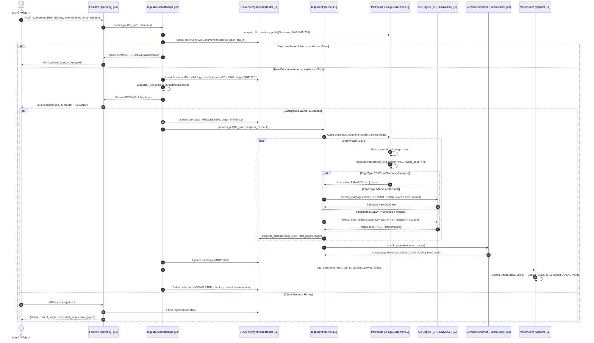
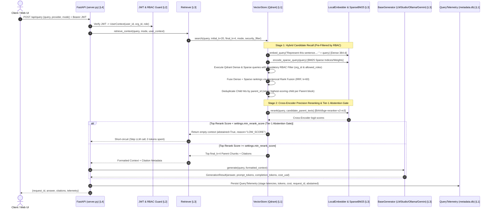

# 🔄 Project-RAG_LLM — System Architecture & Section Matrix (`FLOW.md`)

> **Version Cycle**: `v1.0-restored` $\rightarrow$ `v2.1-active` | **Status**: **ACTIVE & CANONICAL (ADR-010)**
> **Header-First Rule (Tier 2):** Read **Lines 1–42 only** (~450 tokens) for the complete 5-Layer × 6-Section codebase and architecture map. Read Line 43+ only when deep pipeline call sequences or schema flows are needed.

---

## 🗺️ 1. The 5 Horizontal Layers (Bottom-to-Top Stack)

1. **🗄️ Layer 1 — Data, Vector & Relational Persistence (`L1`):**
   - Configuration & Settings: `src/config.py`, `src/__init__.py`, `src/models/__init__.py`, `src/database/__init__.py`, `model_capabilities.yaml`
   - Vector & Lexical Store: `src/database/vector_store.py` (Qdrant `rag_documents` & `rag_documents_v2` with Dense + Sparse BM25 IDF vectors)
   - Relational Metadata DB (v2.1+): `src/database/models.py`, `src/database/relational.py` (`data/metadata.db` via SQLAlchemy for Users, Orgs, Documents, Jobs, Telemetry)
2. **⚙️ Layer 2 — Core Domain, Security & Async Jobs (`L2` — CRUD, RBAC & Workers):**
   - Multi-Tenant Auth & RBAC (v2.4+): `src/auth/security.py`, `src/auth/dependencies.py` (JWT, PBKDF2/bcrypt, Org/Role/Visibility ACLs)
   - Asynchronous Ingestion Queue (v2.1+): `src/jobs/ingestion_worker.py` (`PENDING` $\rightarrow$ `PROCESSING` $\rightarrow$ `COMPLETED`/`FAILED`, SHA-256 deduplication, retries)
3. **🧠 Layer 3 — RAG Intelligence, OCR, Retrieval & Evaluation (`L3` — AI & Math):**
   - Adaptive PDF Ingestion & GPU OCR: `src/ingestion/pdf_parser.py`, `src/ingestion/classifier.py`, `src/ingestion/ocr.py`, `src/ingestion/chunker.py`, `src/ingestion/pipeline.py`, `src/ingestion/__init__.py`
   - Dense & Sparse Embeddings + Reranker: `src/embeddings/embedder.py`, `src/embeddings/sparse_bm25.py` (v2.2+), `src/embeddings/__init__.py`
   - Hybrid Retrieval, RRF & Generation: `src/retrieval/retriever.py`, `src/retrieval/__init__.py`, `src/generation/generator.py`, `src/generation/__init__.py`
   - Automated Evaluation & Telemetry: `src/evaluation/evaluator.py` (v2.3+), `src/utils/logging.py`, `src/utils/telemetry.py` (v2.5+), `src/utils/__init__.py`
4. **🔌 Layer 4 — FastAPI Gateway, Middleware & CLI Entrypoints (`L4`):**
   - REST API & Middleware: `src/api/server.py`, `src/api/auth_routes.py` (v2.4+)
   - CLI Entrypoints: `ingest.py`, `query.py`, `evaluate.py` (v2.3+)
5. **🎨 Layer 5 — Presentation & Web Studio (`L5A` Stateful Views vs. `L5B` Pure Visuals):**
   - **`L5A` Stateful Feature Logic (API-Connected):** `src/api/static/script.js`
   - **`L5B` Pure Visuals (Zero Backend / Stateless UI):** `src/api/static/index.html`, `src/api/static/style.css`

---

## 🧩 2. The 6 Product Sections (2D Layer × Section Matrix)

| Product Section | `L5B` Pure Visuals | `L5A` Stateful UI | `L4` API & CLI | `L3` RAG Intelligence & AI | `L1–L2` Persistence, RBAC & Jobs |
|---|---|---|---|---|---|
| **Sec 1: Hybrid Search & Reranking** | Citation chips, mode badges | Retrieval mode selector | `POST /api/query`, `query.py` | `retriever.py`, `embedder.py`, `sparse_bm25.py` (RRF + CrossEncoder + Abstention) | `vector_store.py` (`rag_documents_v2` Dense + Sparse IDF) |
| **Sec 2: Automated RAG Evaluation** | Benchmark scorecard table | Eval summary modal | `evaluate.py` CLI | `evaluator.py` (Recall@K, MRR, Faithfulness, Citation, Abstention) | `data/eval/benchmark_dataset.json` |
| **Sec 3: JWT Auth & Document RBAC** | Role badges, lock icons | Persona/Role switcher, Login | `POST /api/auth/*`, `auth_routes.py` | Pre-retrieval Qdrant payload filter builder | `security.py`, `models.py` (`User`, `Organization`, `DocumentRecord`) |
| **Sec 4: Observability & Cost Tracking** | Latency & cost pill badges | Metrics dashboard drawer | `GET /api/metrics` | `telemetry.py`, `logging.py`, `generator.py` token/cost counter | `models.py` (`QueryTelemetry`), `model_capabilities.yaml` |
| **Sec 5: Adaptive Ingestion & Async Jobs** | Dropzone, progress bar UI | Job polling & Document list | `POST /api/upload`, `GET /api/jobs/*`, `ingest.py` | `pipeline.py`, `pdf_parser.py`, `classifier.py`, `ocr.py`, `chunker.py` | `ingestion_worker.py`, `models.py` (`IngestionJob`) |
| **Sec 6: Gateway, Resilience & Studio** | Glassmorphic dark theme (`style.css`) | Chat state & error handlers (`script.js`) | `server.py` (CORS, rate limits, health) | Provider fallback (`LMStudio` / `Ollama` / `Gemini`) | `config.py`, `relational.py` |

---

## 🏛️ 3. Master 5-Layer System Stack Diagram (Deep Reference — Line 43+)

> **Layer Dependency Contract (Enforced by `scripts/check_architecture_layers.py`):**
> - **`L5B` (Pure Visuals):** Strictly zero fetch/API calls and zero inline DOM event handlers.
> - **Unidirectional Downward Flow:** `L5A` $\rightarrow$ `L4` $\rightarrow$ `L3` $\rightarrow$ `L2` $\rightarrow$ `L1`. Lower layers (`L1–L3`) never import `L4` (`src/api/server.py`, CLI scripts) or `L5` UI.

```text
+=========================================================================================+
| 🎨 LAYER 5: PRESENTATION & WEB STUDIO (src/api/static/)                                 |
|-----------------------------------------------------------------------------------------|
| [L5B: Pure Visuals — Stateless HTML/CSS]   index.html, style.css                        |
| [L5A: Stateful Feature Client — Fetch API] script.js                                    |
+=========================================================================================+
                                           │  ▲
                         HTTP /api/* JSON  │  │  202 Job Status / Cited Answers / Metrics
                                           ▼  │
+=========================================================================================+
| 🔌 LAYER 4: FASTAPI GATEWAY, MIDDLEWARE & CLI (src/api/, ingest.py, query.py)           |
| • server.py (REST routes, CORS, Rate Limiting, X-Request-ID Tracing)                    |
| • auth_routes.py (JWT Auth endpoints) • CLI: ingest.py, query.py, evaluate.py           |
+=========================================================================================+
                                           │
                                           ▼
+=========================================================================================+
| 🧠 LAYER 3: RAG INTELLIGENCE, OCR, HYBRID RETRIEVAL & EVALUATION (src/)                 |
| • Ingestion: pipeline.py -> pdf_parser.py -> classifier.py -> ocr.py -> chunker.py      |
| • Embeddings & Rerank: embedder.py (BGE-small + BGE-reranker-v2-m3), sparse_bm25.py     |
| • Retrieval & Generation: retriever.py (RRF + Two-Tier Abstention), generator.py        |
| • Evaluation & Telemetry: evaluation/evaluator.py, utils/telemetry.py, utils/logging.py |
+=========================================================================================+
                                           │
                                           ▼
+=========================================================================================+
| ⚙️ LAYER 2: CORE DOMAIN, MULTI-TENANT RBAC & ASYNC JOBS (src/auth/, src/jobs/)          |
| • ingestion_worker.py (Background Worker Pool, Retries, Crash Recovery, Deduplication)  |
| • security.py & dependencies.py (JWT Sign/Verify, Role Hierarchy, Pre-Retrieval ACLs)   |
+=========================================================================================+
                                           │
                                           ▼
+=========================================================================================+
| 🗄️ LAYER 1: DATA, VECTOR & RELATIONAL PERSISTENCE (src/database/, src/config.py)        |
| • vector_store.py (Qdrant Persistent Store: Dense 384-d Cosine + Sparse BM25 IDF)       |
| • relational.py & models.py (SQLAlchemy ORM: SQLite data/metadata.db / PostgreSQL)      |
+=========================================================================================+
```

---

## 🔄 4. End-to-End Execution Sequence Diagrams

### Flow A: Asynchronous Document Ingestion & Adaptive OCR Pipeline (`Sec 5`)



---

### Flow B: Authenticated Hybrid Search, RRF, Cross-Encoder Reranking & Two-Tier Abstention (`Sec 1, Sec 3, Sec 4`)



---

## 📂 5. Complete Module Responsibilities & Layer Manifest

| File Path | Layer | Sections | Primary Responsibility |
| :--- | :---: | :---: | :--- |
| `src/config.py` | `L1` | `Sec 1–6` | Pydantic `BaseSettings` reading `RAG_*` env vars from `.env`; directory initialization. |
| `src/database/models.py` | `L1` | `Sec 3,4,5` | SQLAlchemy 2.0 ORM models (`Organization`, `User`, `DocumentRecord`, `IngestionJob`, `QueryTelemetry`). |
| `src/database/relational.py` | `L1` | `Sec 3,4,5,6` | SQLAlchemy engine, session factory (`SessionLocal`), and `init_db()` schema bootstrapper. |
| `src/database/vector_store.py` | `L1` | `Sec 1,3,5` | Qdrant client managing `rag_documents` (v1) and `rag_documents_v2` (Dense + Sparse BM25 IDF, RRF, RBAC filters). |
| `src/jobs/ingestion_worker.py` | `L2` | `Sec 5` | `IngestionJobManager`: `ThreadPoolExecutor` worker pool, SHA-256 deduplication, retries, and crash recovery. |
| `src/auth/security.py` | `L2` | `Sec 3` | Password hashing (`PBKDF2`/`bcrypt`), JWT token signing/verification (`HS256`), and role hierarchy rules. |
| `src/auth/dependencies.py` | `L2` | `Sec 3` | FastAPI `Depends` extractors for current `User` and Qdrant RBAC `models.Filter` construction. |
| `src/ingestion/pdf_parser.py` | `L3` | `Sec 5` | Streaming `SHA-256` file hashing and single-handle `fitz.Document` page text/image extraction. |
| `src/ingestion/classifier.py` | `L3` | `Sec 5` | 3-way page routing heuristic (`TEXT`, `IMAGE`, `MIXED`) based on `text_threshold=50` and `image_count`. |
| `src/ingestion/ocr.py` | `L3` | `Sec 5` | Lazy GPU `EasyOCR` wrapper, 200 DPI rasterizer with 50MB recursive pixmap guard, XREF region OCR, and page timeout. |
| `src/ingestion/chunker.py` | `L3` | `Sec 1,5` | Hierarchical paragraph/sentence chunker with word-safe overlap, header detection, and v2.2 Cross-Page Parent-Child blocks. |
| `src/ingestion/pipeline.py` | `L3` | `Sec 5` | End-to-end PDF coordinator wiring parser, classifier, OCR, RAM pressure guard (`psutil`), progress callbacks, and chunker. |
| `src/embeddings/embedder.py` | `L3` | `Sec 1` | Lazy GPU loader for `BAAI/bge-small-en-v1.5` (with query prefix) and `BAAI/bge-reranker-v2-m3` (`CrossEncoder`). |
| `src/embeddings/sparse_bm25.py` | `L3` | `Sec 1` | Deterministic lexical tokenizer preserving technical identifiers/codes for Qdrant Sparse IDF vectors. |
| `src/retrieval/retriever.py` | `L3` | `Sec 1` | Context assembler, citation extractor, and Two-Tier Abstention Gate coordinator. |
| `src/generation/generator.py` | `L3` | `Sec 1,4,6` | Strategy factory (`LMStudioGenerator`, `OllamaGenerator`, `GeminiGenerator`) with grounded prompt isolation and token/cost accounting. |
| `src/evaluation/evaluator.py` | `L3` | `Sec 2` | Automated benchmark runner computing `Recall@K`, `MRR`, `Faithfulness`, `Citation Accuracy`, and `Abstention`. |
| `src/utils/logging.py` | `L3` | `Sec 4,6` | `loguru` console + rotating file (`logs/rag_pipeline.log`) logger configuration. |
| `src/utils/telemetry.py` | `L3` | `Sec 4` | High-resolution stage timer context manager (`embed`, `search`, `rerank`, `llm`) and p50/p95 aggregator. |
| `src/api/server.py` | `L4` | `Sec 1,3,4,5,6` | FastAPI application exposing `/api/upload`, `/api/jobs/*`, `/api/documents/*`, `/api/query`, and `/api/metrics`. |
| `src/api/auth_routes.py` | `L4` | `Sec 3` | FastAPI router for `/api/auth/register`, `/api/auth/login`, and `/api/auth/me`. |
| `src/api/static/script.js` | `L5A` | `Sec 1,3–6` | Frontend controller handling drag-and-drop uploads, job polling, provider/mode toggles, chat rendering, and citation chips. |
| `src/api/static/index.html` | `L5B` | `Sec 1,3–6` | Semantic HTML5 layout for the RAG Web Studio. |
| `src/api/static/style.css` | `L5B` | `Sec 6` | Dark-mode glassmorphic stylesheet and micro-animations. |
